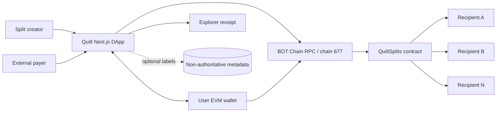
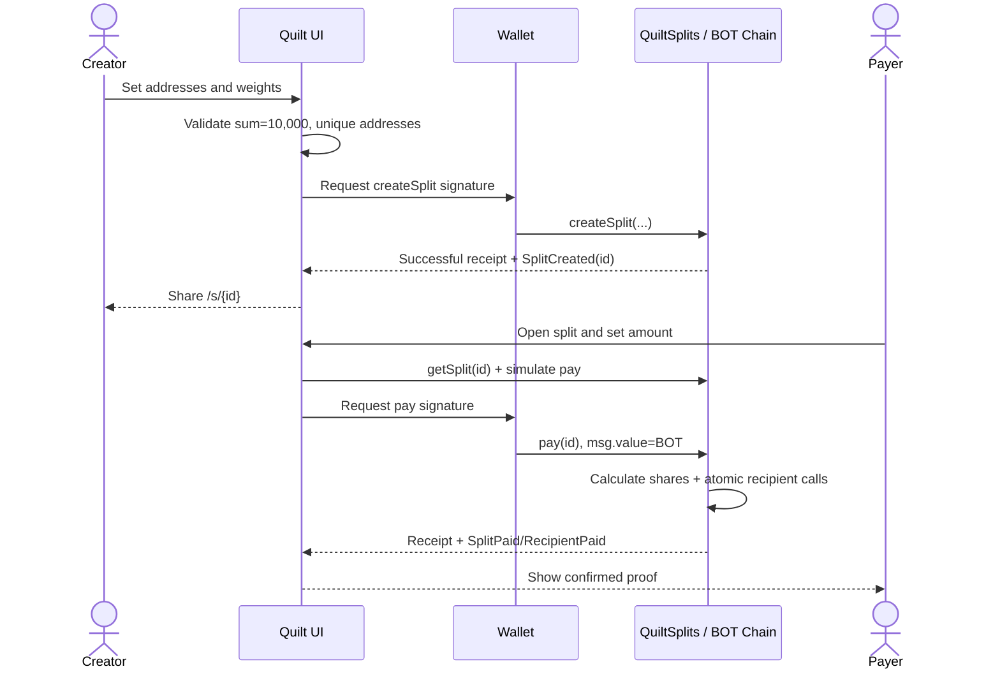

# Quilt — System Architecture

**Version:** v1.0 · **Date:** 2026-11-10 · **Architecture style:** direct-to-contract frontend, no custody backend.

## 1. Architecture decision

Quilt should be intentionally small: the EVM contract is the system of record; browsers read from a public RPC and obtain wallet signatures for writes. Optional API-backed labels/analytics must not be able to change recipient allocations or redirect payouts. This avoids the operational and trust burden of hosting a payment custody service.



## 2. Components and ownership

| Component | Responsibility | Authority |
| --- | --- | --- |
| Web UI | Create form, share page, preview, error states | None over funds |
| Wallet provider | Sign transactions, expose address and active chain | Controls only user's key |
| `QuiltSplits` | Save immutable splits and atomically forward BOT | Canonical allocations and events |
| BOT Chain RPC | Chain reads, gas simulations, receipt retrieval | Chain data source; validate chain ID |
| Explorer | Independent verification of contracts and transactions | Public read-only evidence |
| Optional metadata store | Friendly split titles and analytics | Non-authoritative; deletable |

## 3. Canonical data model

```text
Split
  id: uint256
  creator: address
  recipients: address[2..5]
  weightsBps: uint16[2..5], sum = 10000
  exists: bool

Events
  SplitCreated(splitId, creator)
  RecipientPaid(splitId, recipient, amount)
  SplitPaid(splitId, payer, totalAmount)
```

If a database exists, key records by `(chainId, contractAddress, splitId)`. A DB row must never overwrite recipients or bps from `getSplit`. Split IDs may be enumerable by `splitCount`/events for a simple MVP. Cache reads with a short stale threshold, not as a source of truth.

## 4. Create and pay sequence



## 5. Trust boundaries

- **Browser → Contract:** Browser input is untrusted. Contract enforces unique wallets, weights and value conditions.
- **Wallet → Chain:** Verify signed chain ID 677 and canonical contract address; show amounts before wallet confirmation.
- **Contract → Recipient:** Recipient is potentially adversarial; prevent reentrancy and revert if any payout fails.
- **Metadata → UI:** Titles and icons are untrusted, sanitized display-only data. Cannot influence payment destination.
- **RPC → UI:** Show pending/unknown during outages; use transaction receipt + event verification before confirming success.

## 6. Deliberate simplifications

- One contract with append-only split IDs; no upgradeable proxy, access-control admin, on-chain platform fees, oracle or database dependency.
- Native BOT payouts only. Do not implement BDEX integration in launch scope.
- No team authentication or username binding; wallets are the sole payout identifiers.
- If contract recipient rejection proves too common, revisit a pull-payment design as a *post-launch product change*, not an undocumented hot fix.

## 7. Resilience and operations

Configure health monitoring for the web route, a known contract `getSplit` read and a public RPC `eth_chainId` check. Maintain an alternative RPC only after verifying chain identity and transaction consistency. Alerts should distinguish website outage, wallet provider trouble, RPC failure and actual contract revert. Back up source, ABI and deployment artifacts; contract code is immutable after launch.

## 8. Repository and release structure

```text
quilt/
  app/{page.tsx,create/page.tsx,s/[splitId]/page.tsx,about/page.tsx}
  components/{wallet,split-builder,payout-preview,receipt}
  lib/{chain.ts,contract.ts,amounts.ts,errors.ts}
  contracts/src/QuiltSplits.sol
  contracts/test/{QuiltSplits.t.sol,QuiltSplitsInvariant.t.sol}
  contracts/script/{Deploy.s.sol}
  public/{brand-assets}
  docs/{PRD.md,TRD.md,architecture.md,projectplan.md}
```

## 9. Architectural acceptance tests

- Fresh browser loads public `/s/{id}` without any user account.
- Contract returns the same recipient/weight data the UI displays.
- `sum(recipient payouts) == msg.value` for all successful payments.
- No external service stores private keys or has a privileged way to alter a split.
- Mainnet contract address and explorer receipts match deployed ABIs and chain 677.

**Related documents:** [`PRD.md`](./PRD.md), [`TRD.md`](./TRD.md), [`projectplan.md`](./projectplan.md).
